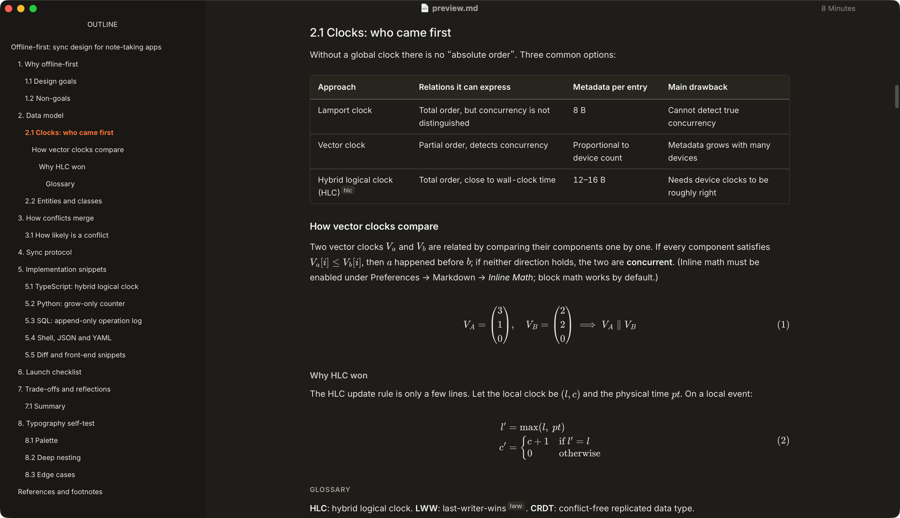

# Cursor Style

[](LICENSE)
[](https://github.com/OldJii/typora-cursor-theme/releases/latest)

A [Typora](https://typora.io) theme in the visual language of Cursor's website: warm paper background, ink-colored text and a restrained ember orange. It starts from Typora's bundled GitHub light theme, keeps its mature typographic skeleton and native editing feel, and re-implements only the look: colors, type hierarchy and display rules. A matching dark variant, **Cursor Style Dark**, is included. Designed for technical writing and long-form reading.

> A community work, not affiliated with or endorsed by Anysphere / Cursor. "Cursor" in the name only identifies the style that inspired the theme, and is a trademark of its owner. The dark variant is derived from the same design tokens; it is not an official Cursor palette.


## Features

- **Built on the GitHub theme.** The document skeleton, block geometry and editing-related rules come from Typora's bundled `github.css`, so the caret, selection, IME, and the native editing behavior of tables and code blocks are untouched. This theme only replaces colors, fonts, spacing and display rules.
- **One text column.** Body text, headings, lists, quotes, code blocks, tables, images, math and Mermaid diagrams share a single column, `56rem` by default (about 896 px at a 16 px font size), with both edges aligned and no second "wide" column. Content wider than the column is handled inside it: code blocks wrap (or scroll inside the block when wrapping is off), tables with 7 or more columns and display math scroll horizontally within their frame, and images and diagrams scale down proportionally. In a window narrower than the column, the column narrows with it.
- **Paper and ink.** Paper `#f7f7f4`, ink `#26251e`; orange is reserved for the caret, links, focus and the current item. The brand orange `#f54e00` has only 3.3:1 contrast on paper, so text and links use a deeper `#c43e00` (4.9:1). Body text and the small gray text (12.7, 7.1 and 5.5:1) meet WCAG AA; only Markdown markup characters and focus-mode dimmed text are deliberately fainter.
- **Light headings, clear hierarchy.** h1–h6 stay at weights 500–600 with no divider lines; levels are told apart by size, letter-spacing, color and spacing. Space above a heading is at least twice the space below it, so a heading sits close to the content it introduces, and a heading directly under a higher-level heading gets a smaller gap. Bold and emphasis are easy to tell apart.
- **Made for long-form reading.** Inter with system CJK fonts, line height 1.8, `line-break: strict` for CJK punctuation and line breaking, JetBrains Mono for code and EB Garamond for quotes.
- **Complete coverage.** Headings, lists, task lists, quotes, inline code and code blocks (with syntax highlighting), tables, images with captions, table of contents, footnotes, math, Mermaid, YAML front matter, `<details>`, find, focus and source code modes, sidebar, scrollbars, menus and dialogs, and print styles.
- **Mermaid follows the theme.** Flowcharts, state diagrams, sequence diagrams, class diagrams, ER diagrams, Gantt charts and pie charts share one palette, identical in light and dark.
- **Presentation only.** Pure CSS: no scripts, no network access. Font sizes and column width are all in `rem`, so they follow Typora's font size setting. With Preferences → Appearance → Font Size left on "Auto" the root size is 16 px, and every pixel figure in this document assumes that; with a custom size (say 14 px), font sizes, line spacing and column width shrink proportionally.

## Screenshots

| Light | Dark |
|---|---|
|  |  |
|  |  |
|  |  |
|  |  |

## Installation

1. Download [`cursor-style.zip`](https://github.com/OldJii/typora-cursor-theme/releases/latest/download/cursor-style.zip) from the latest release and unzip it. (You can also use this repository directly.)
2. In Typora, open Preferences → Appearance → Open Theme Folder.
3. Copy `cursor-style.css`, `cursor-style-dark.css` and the whole `cursor-style/` folder into it, then restart Typora.
4. Choose **Cursor Style** or **Cursor Style Dark** from the Themes menu. Alternatively, tick "Use a separate theme in dark mode" under Preferences → Appearance and pick a light and a dark theme.

[`preview.md`](preview.md) is a sample document that uses every element the theme styles. Inline math, sub/superscript and highlight in it need to be enabled first under Preferences → Markdown.

## Customization

Create `cursor-style.user.css` (or `cursor-style-dark.user.css` for the dark variant) in the theme folder and override the variables you want:

```css
:root {
  --cs-measure: 64rem;          /* text column width; default 56rem. Use 46rem for a narrower reading width */
  --cs-gutter: 2.5rem;          /* space between the column and the window edge; default 2rem (1.25rem below 40rem windows) */
  --cs-leading: 1.7;            /* body line height; default 1.8 */
  --cs-code-ligatures: normal;  /* enable JetBrains Mono programming ligatures; default none */
}
```

Override the font stacks with `--cs-font-sans`, `--cs-font-serif` and `--cs-font-mono`. All color tokens (`--cs-*`) are in the `:root` block at the top of `cursor-style.css` and `cursor-style-dark.css`. The scrollbar thumb colors for the normal, hover and pressed states are `--cs-scrollbar`, `--cs-scrollbar-hover` and `--cs-scrollbar-active`.

Mermaid's hand-drawn look (`look: handDrawn`) needs a newer Mermaid engine and has to be configured inside the diagram itself, so it cannot be done from theme CSS and the theme does not try to imitate it.

## Fonts

Inter, EB Garamond and JetBrains Mono are bundled in `cursor-style/fonts/` as Latin-subset variable fonts. All three are licensed under the SIL OFL 1.1; the full license texts are in the `OFL-*.txt` files next to them. CJK text always uses system fonts (PingFang SC, Microsoft YaHei, Noto Sans CJK SC and so on). Typora strips `@font-face` rules when exporting HTML, so exported pages fall back to system fonts; the font stacks are designed with that in mind.

## Compatibility

**Tested** in Typora 1.5.6 on macOS 26 (Mermaid 9.3.0), light and dark:

- Reading view: front matter, h1–h6, paragraphs, lists, quotes, tables (including wide tables with horizontal scrolling), math, code blocks and Mermaid diagrams.
- Outline sidebar, file tree and the custom scrollbars (content area, sidebar, wide tables and source code mode); the thumb's hover and pressed colors were only checked in Chromium.
- Window widths of 1470 pt (with sidebar), 900 pt (with file tree) and 520 pt (no sidebar, light).
- The editing states of math and HTML blocks, find, source code mode, focus mode and the dark theme in a narrow window were checked on an earlier revision. Later changes did not touch them (compared line by line against the earlier stylesheets), but they were not exercised again.
- HTML export of the light theme, rendered in Chromium at 1100 px and 440 px wide: wide tables, Gantt, pie, ER and class diagrams.

**Not verified:**

| Area | Status |
|---|---|
| Windows, Linux | Not verified |
| Other Typora versions (including versions that bundle a newer Mermaid) | Not verified |
| PDF export and physical printing | Print styles follow the text column but were not exported and checked in the app |
| Heading edit state (the h3–h6 markers in the margin while the caret is in a heading), narrow-window headings | Not re-checked after the latest heading spacing changes |
| HTML export of the dark theme (the file was exported but not rendered), IME composition, automatic light/dark switching, typewriter mode, spell-check hints | Not verified |

## Known limitations

- **Pie chart legend.** The Mermaid bundled with Typora 1.5 lays out pie charts by the text column width and fixes the legend about 238 px to the right of the center. With the default column about 210 px remain for legend text, enough for a label plus its `[value]` of around a dozen characters; when the column is narrower than about 480 px (a narrow window, or a small window with a sidebar), longer labels are clipped. Adding `%%{init: {"pie": {"useWidth": 800}}}%%` as the first line of the diagram scales the whole pie so the legend fits, at the cost of smaller text.
- **CSS `:has()`.** The table width split (6 columns or fewer wrap inside the column; 7 or more take their content width and scroll inside the frame) and image captions (an emphasis-only paragraph directly after an image) rely on `:has()`. Where it is not supported, tables wrap inside the column and captions render as ordinary paragraphs.
- **HTML export** does not embed fonts, and images keep their relative paths, so move the images along with the HTML file.
- **Mermaid diagram types.** Besides the seven diagram types listed above, other types keep the colors of the built-in neutral (light) or dark (dark) Mermaid theme.
- **Scrollbars are always visible.** The theme draws its own scrollbars (one 6 px thin thumb shared by the content area, sidebar, code blocks, wide tables and menus, with colors that follow the light or dark theme), so they no longer follow the macOS "Show scroll bars: when scrolling" setting. To get the system scrollbars back, delete the "Scrollbars" section from `cursor-style/base.css`.
- **Windows unified window style.** There is no dedicated adaptation for it.

## Repository layout

```
cursor-style.css          Light theme entry point: color tokens
cursor-style-dark.css     Dark theme entry point: color tokens
cursor-style/             Shared styles (base.css) and fonts
preview.md                Sample document (its image is in preview-assets/)
release/cursor-style.zip  Install package: unzip into Typora's theme folder
gallery/                  Typora Theme Gallery post, thumbnail and screenshots
LICENSE                   MIT; GitHub theme derivation note; fonts: see cursor-style/fonts/OFL-*.txt
```

## Contributing

Bug reports and pull requests are welcome. When you open an issue, please include your Typora version, operating system, the theme (light or dark) and a screenshot if you can. Please keep the theme pure CSS: no scripts and no network requests.

## License

[MIT](LICENSE). The parts derived from Typora's bundled GitHub theme are not covered by the MIT license; see `LICENSE` for the note. The bundled fonts are licensed under the SIL OFL 1.1.

The theme is published by [OldJii](https://github.com/OldJii) at [OldJii/typora-cursor-theme](https://github.com/OldJii/typora-cursor-theme).
