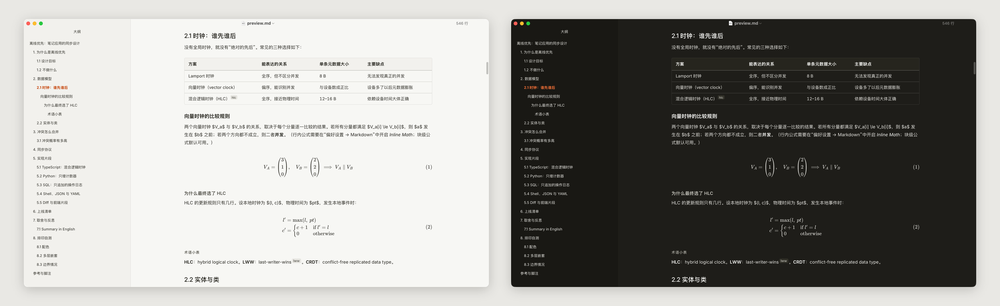
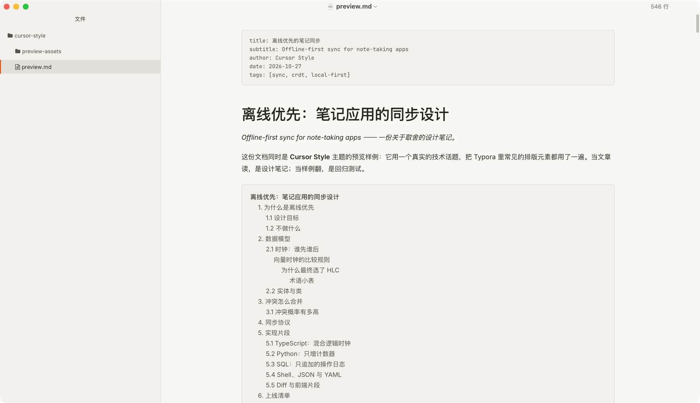
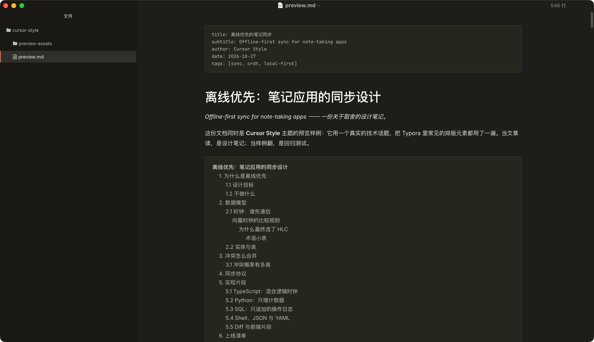
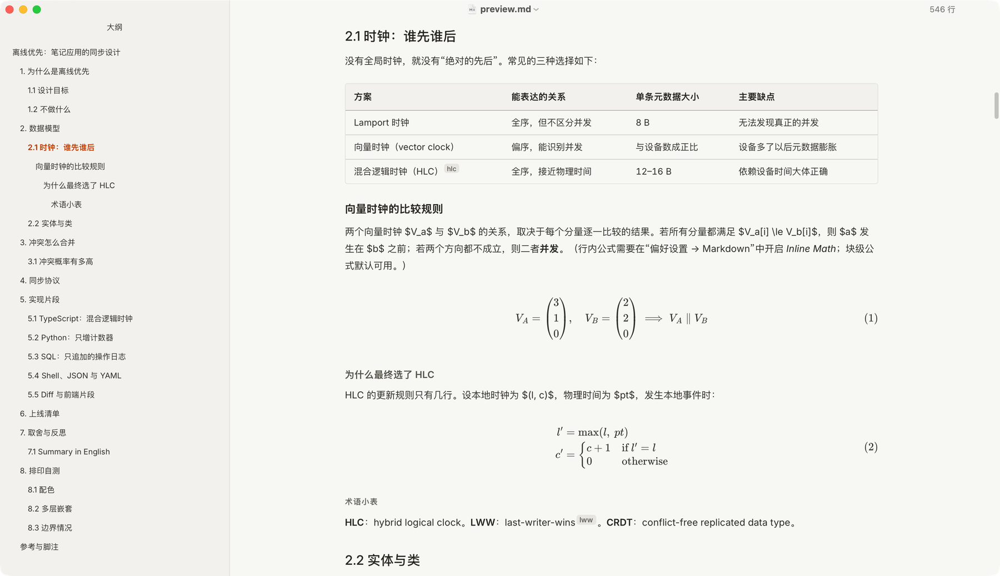
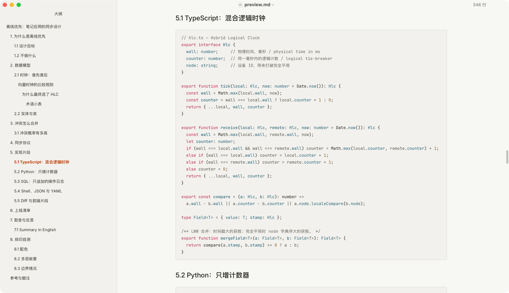
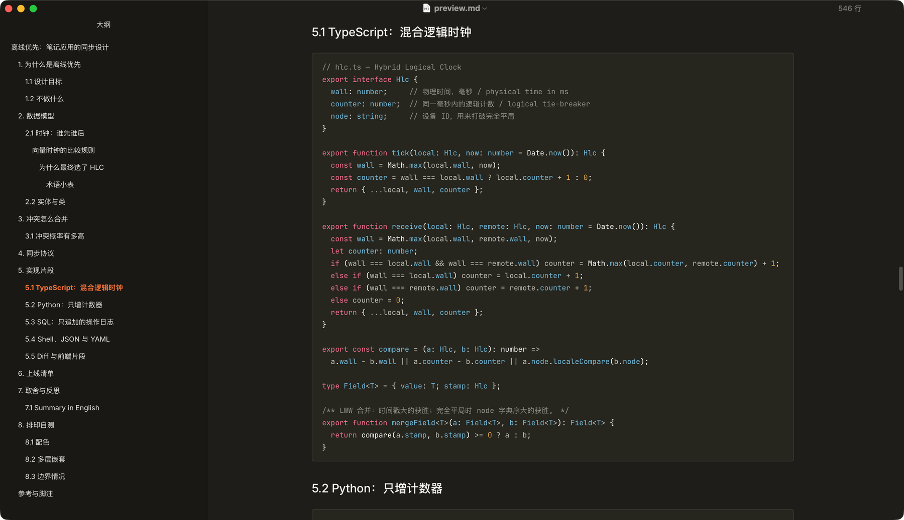
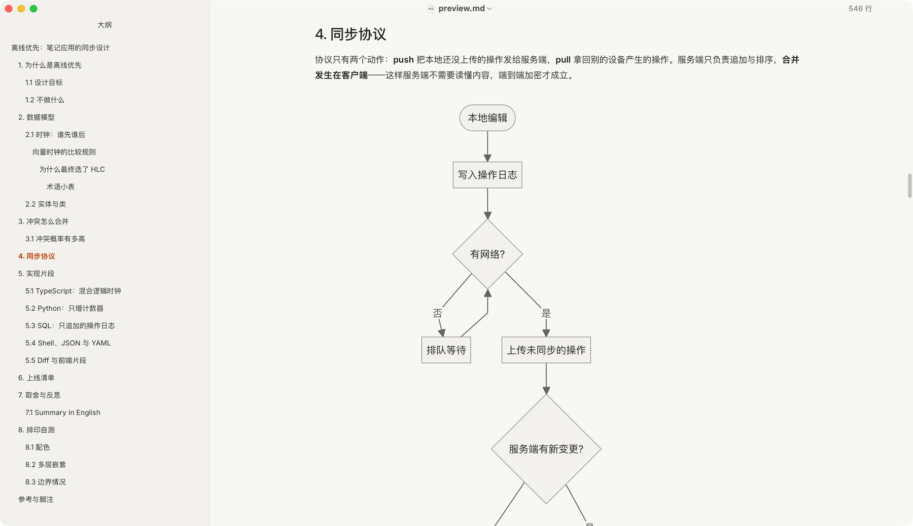
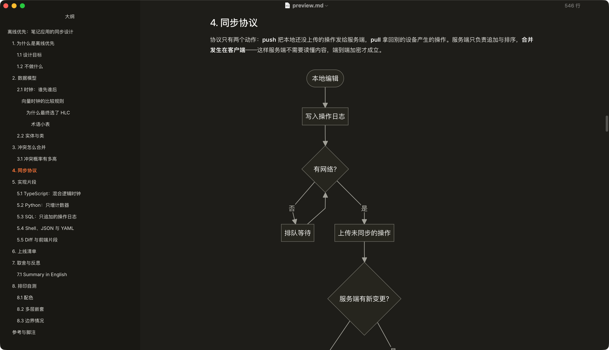

# Cursor Style

Cursor 风格的 Typora 主题：以 Typora 自带的 GitHub 浅色主题为底，重新实现 Cursor 官网的视觉语言——暖纸色背景、墨色文字、克制的 ember 橙。保留 GitHub 主题成熟的排版骨架和 Typora 原生的编辑手感，只重新实现视觉：配色、字体层级和展示规则。另附配套暗色版 Cursor Style Dark。为中英文混排的技术写作和长文阅读而做。

> 社区作品，与 Anysphere / Cursor 无隶属或背书关系；名称里的“Cursor”只说明风格来源，是其所有者的商标。暗色版由同一套设计令牌推导而来，不是 Cursor 官方配色。



## 设计

- **以 GitHub 主题为底**：文档骨架、块级几何和编辑相关规则沿用 Typora 自带的 `github.css`，光标、选区、输入法和表格、代码块的原生编辑行为不被改动；本主题只替换颜色、字体、间距和展示规则。
- **一个版心**：正文、标题、列表、引用、代码块、表格、图片、公式和 Mermaid 共用同一个版心，默认 56rem（16 px 字号下约 896 px，一行约 56 个汉字），左右边缘对齐，没有第二个“宽栏”。比版心宽的内容留在版心里处理：代码块自动换行（关闭换行时在块内滚动），7 列及以上的表格和行间公式在框内横向滚动，图片与图表按比例缩小。窗口比版心窄时，版心随窗口收窄。
- **纸与墨**：纸色 `#f7f7f4`、墨色 `#26251e`，橙色只用于光标、链接、焦点和当前项。品牌橙 `#f54e00` 在纸色上只有 3.3:1，文字和链接改用更深的 `#c43e00`（4.9:1）；正文与小号灰字（12.7、7.1、5.5:1）达到 AA，只有 Markdown 标记符号和专注模式的淡化文字刻意更淡。
- **标题轻，层级清楚**：h1–h6 保持 500–600 字重，不带分隔线，靠字号、字距、颜色和间距区分层级；标题上方的空白至少是下方的两倍，让标题贴着它引出的内容，紧跟在更高一级标题下面的标题只留较小的间距。加粗和强调在视觉上能一眼分开。
- **中文长文阅读**：正文 Inter 加系统中文字体，行高 1.8；引号、破折号和省略号交给中文字体，保持全角居中；中文标点和断行按 `line-break: strict` 处理；代码用 JetBrains Mono，引用用 EB Garamond。
- **覆盖完整**：标题、列表、任务列表、引用、行内代码与代码块（含语法高亮）、表格、图片与题注、目录、脚注、公式、Mermaid、YAML front matter、`<details>`、查找、专注与源代码模式、侧边栏、滚动条、菜单和对话框，以及打印样式。
- **Mermaid 随主题换色**：流程图、状态图、时序图、类图、ER 图、甘特图、饼图共用一套色板，浅色与暗色一致。
- **只负责呈现**：纯 CSS，不含脚本、不联网。字号和版心宽度全部使用 `rem`，跟随 Typora 的字体大小设置：偏好设置 → 外观 → 字体大小保持「自动」时根字号是 16 px，本文的像素数都按这个算；选了「自定义」（比如 14 px），字号、行距和版心宽度按比例一起缩小。

## 截图

| 浅色 | 暗色 |
|---|---|
|  |  |
|  |  |
|  |  |
|  |  |

## 安装与使用

1. 解压 `release/cursor-style.zip`（也可以直接使用本目录）。
2. Typora → 偏好设置 → 外观 → 打开主题文件夹。
3. 把 `cursor-style.css`、`cursor-style-dark.css` 和整个 `cursor-style/` 文件夹放进去，重启 Typora。
4. 在「主题」菜单选择 Cursor Style 或 Cursor Style Dark。也可以在偏好设置 → 外观勾选「在深色模式下使用独立的主题」，分别指定浅色和深色主题。

`preview.md` 是中英文双语样张，用到了主题处理的全部元素。其中的行内公式、上下标和高亮需要先在偏好设置 → Markdown 中开启。

## 自定义

在主题文件夹新建 `cursor-style.user.css`（暗色版用 `cursor-style-dark.user.css`），覆盖变量即可：

```css
:root {
  --cs-measure: 64rem;          /* 版心宽度，默认 56rem；想要更窄的阅读宽度可设 46rem（改版前的默认值） */
  --cs-gutter: 2.5rem;          /* 版心与窗口边缘的间距，默认 2rem（窗口窄于 40rem 时 1.25rem） */
  --cs-leading: 1.7;            /* 正文行高，默认 1.8 */
  --cs-code-ligatures: normal;  /* 开启 JetBrains Mono 的编程连字，默认 none */
}
```

字体栈用 `--cs-font-sans`、`--cs-font-serif`、`--cs-font-mono` 覆盖。全部颜色令牌（`--cs-*`）在 `cursor-style.css` 与 `cursor-style-dark.css` 顶部的 `:root` 里；滚动条滑块的常态、悬停和按下颜色是 `--cs-scrollbar`、`--cs-scrollbar-hover`、`--cs-scrollbar-active`。

Mermaid 的手绘风格（`look: handDrawn`）需要更新的 Mermaid 引擎，并要在图表内部配置，无法靠主题 CSS 实现，所以主题没有去模拟。

## 字体

Inter、EB Garamond、JetBrains Mono 以拉丁字符子集的可变字体随主题打包在 `cursor-style/fonts/`，均为 SIL OFL 1.1，许可证全文在同目录的 `OFL-*.txt`。中文一律使用系统字体（PingFang SC、微软雅黑、Noto Sans CJK SC 等）。Typora 导出 HTML 时会去掉 `@font-face`，导出的页面改用系统字体，字体栈已按此设计。

## 兼容性

| 范围 | 状态 |
|---|---|
| Typora 1.5.6（macOS 26），去掉 h1、h2 分隔线并重调标题间距之后 | 已在真机检查（窗口宽 1470 pt，带侧栏，字体大小「自定义 14 px」）：浅色与暗色的文档开头（front matter、h1、副标题与正文）、h2 接段落、h4、h3 接代码块、流程图前的 h2；暗色下 h2 紧跟 h3、分隔线（`---`）后的 h2；浅色下第 8 节的 h3 接段落与列表。没有重新检查：标题的编辑状态（光标在标题里时边距里的 h3–h6 标记）、窄窗口、打印 |
| 同一版本，自绘滚动条之后、去掉标题分隔线之前 | 已在真机检查：浅色与暗色的内容区、大纲侧栏、宽表格的横向滚动条和源代码模式，取色、粗细和位置符合预期（滑块与纸色、侧栏底色的像素值与令牌一致）。滑块的悬停和按下颜色只在 Chromium 里核对过，Typora 里没能触发悬停，没有实测；文件树和搜索结果面板的滚动条套用同一条规则，没有单独看 |
| Typora 1.5.6（macOS 26，Mermaid 9.3.0），改名并加宽版心（56rem）之后、滚动条改动之前 | 已在真机重新检查：浅色与暗色的阅读、表格、公式、代码块和流程图；侧边栏文件树与大纲；窗口宽 1470 pt（带侧栏）、900 pt（带文件树）、520 pt（无侧栏，浅色）。浅色导出的 HTML 用 Chromium 在 1100 px 和 440 px 宽度下检查了宽表格、甘特图、饼图、ER 图和类图 |
| 同一版本，改名前（版心 46rem）已检查 | 公式与 HTML 块的编辑状态；查找；源代码模式；专注模式；暗色的窄窗口。之后样式改了名称、版心宽度、滚动条和标题（名称与版心的改动用新旧样式表逐行比对过），除滚动条和标题外没有改动这些部分，但没有在新版心下重新操作一遍 |
| Windows、Linux | 未验证 |
| 其他 Typora 版本（包括内置更新 Mermaid 的版本） | 未验证 |
| PDF 与实体打印 | 打印样式已随版心重写，但没有在真机导出验证 |
| 暗色主题的 HTML 导出（只导出了文件，没有渲染检查）、中文输入法组字、跟随系统明暗自动切换、打字机模式、拼写检查提示 | 未验证 |

## 已知限制

- 饼图的图例：Typora 1.5 自带的 Mermaid 按版心宽度排布饼图，并把图例固定在圆心右侧约 238 px 处。默认版心下图例文字有约 210 px 的位置，约 12 个汉字加 `[数值]` 以内可以完整显示；版心窄于约 480 px 时（窄窗口、带侧栏的小窗口），较长的标签会被裁掉。在图表开头加一行 `%%{init: {"pie": {"useWidth": 800}}}%%` 可以整体缩放饼图，让图例放得下，代价是文字变小。
- 表格宽窄分流（6 列及以下在版心内换行，7 列及以上按内容取宽并在框内滚动）和图片题注（图片后紧跟、只含强调的一行段落）依赖 CSS `:has()`。不支持 `:has()` 的版本里，表格在版心内换行，题注按普通段落显示。
- HTML 导出不内嵌字体；图片保持相对路径，移动 HTML 文件后要连同图片一起移动。
- 上面列出的七类 Mermaid 图之外，其他图类型沿用内置 neutral（浅色）或 dark（暗色）主题的配色。
- 滚动条始终可见：主题自绘了滚动条（内容区、侧边栏、代码块、宽表格和菜单共用一种 6 px 的细滑块，颜色随明暗主题变化），所以不再跟随 macOS「滚动条显示」里的“滚动时显示”。想用回系统滚动条，删掉 `cursor-style/base.css` 里「Scrollbars」那一段即可（这段加入之前就是系统滚动条）。
- 没有针对 Windows「一体化」窗口样式的专门适配。

## 目录

```
cursor-style.css          浅色主题入口：配色令牌
cursor-style-dark.css     暗色主题入口：配色令牌
cursor-style/             共用样式 base.css 与字体
preview.md                双语样张（配图在 preview-assets/）
release/cursor-style.zip  解压后放进 Typora 主题文件夹即可的安装包
gallery/                  Typora Theme Gallery 的投稿材料（尚未提交）
LICENSE                   MIT；GitHub 主题衍生说明；字体另见 cursor-style/fonts/OFL-*.txt
```

## Typora Theme Gallery 材料

主题源码与安装包由 [OldJii](https://github.com/OldJii) 发布于 [typora-cursor-theme](https://github.com/OldJii/typora-cursor-theme)。[下载主题](https://github.com/OldJii/typora-cursor-theme/releases/latest/download/cursor-style.zip)。

`gallery/` 保存主题库投稿文章、缩略图和展示图片；投稿状态以官方仓库的 Pull Request 为准。

## 许可

MIT，见 `LICENSE`。派生自 Typora 自带 GitHub 主题的部分不在 MIT 授权范围内，说明见 `LICENSE`；字体为 SIL OFL 1.1。
