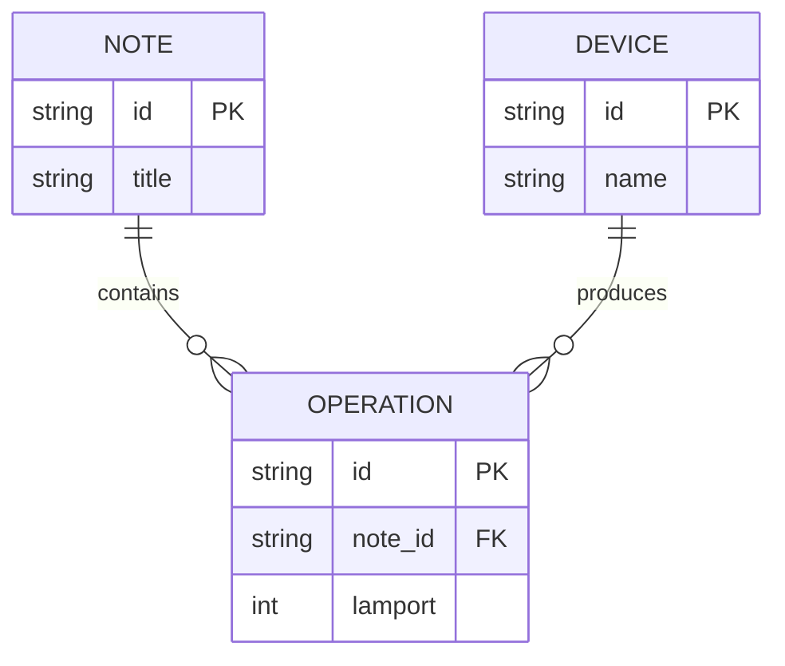
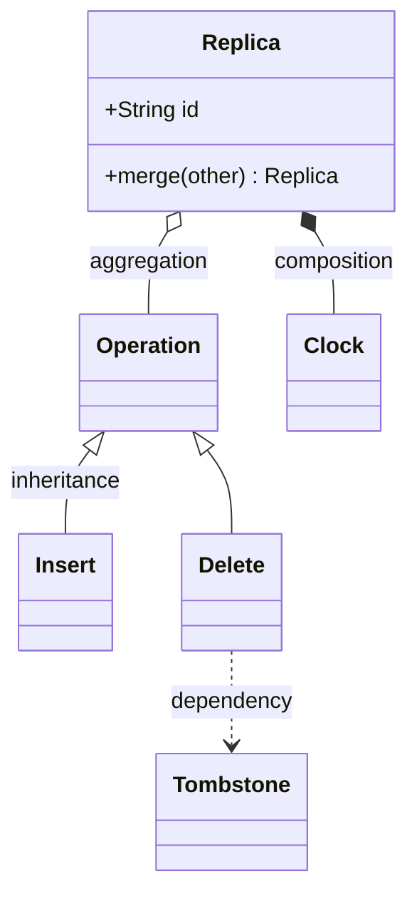
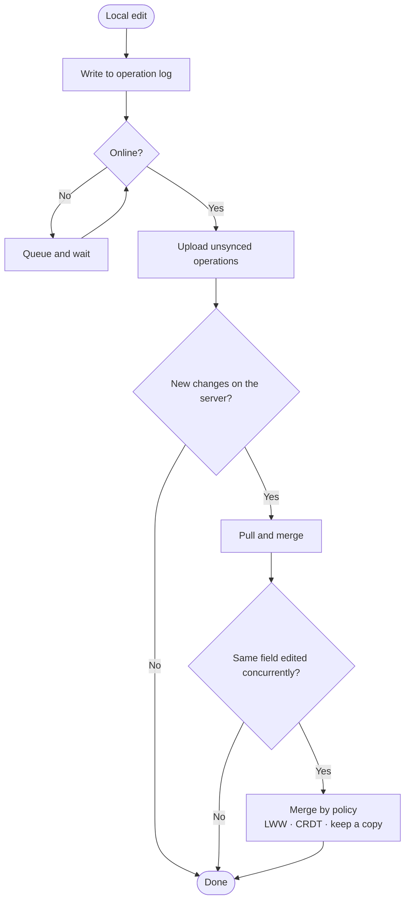
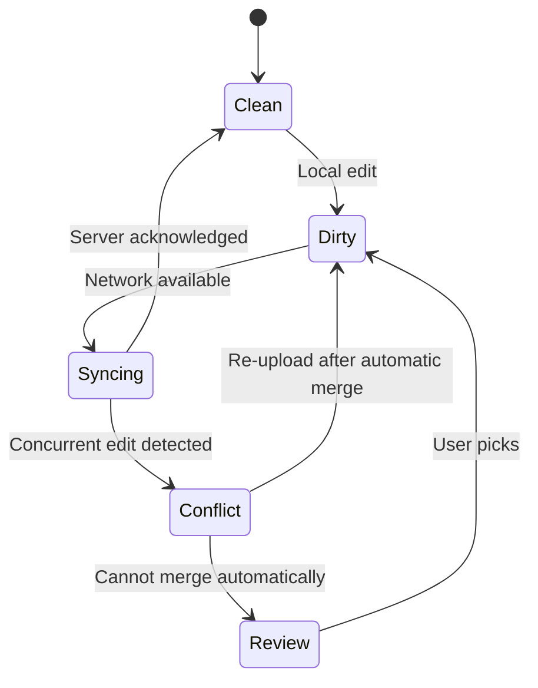
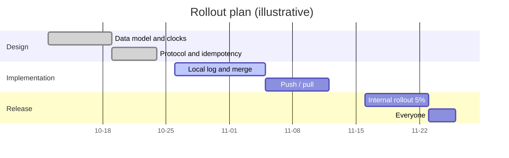
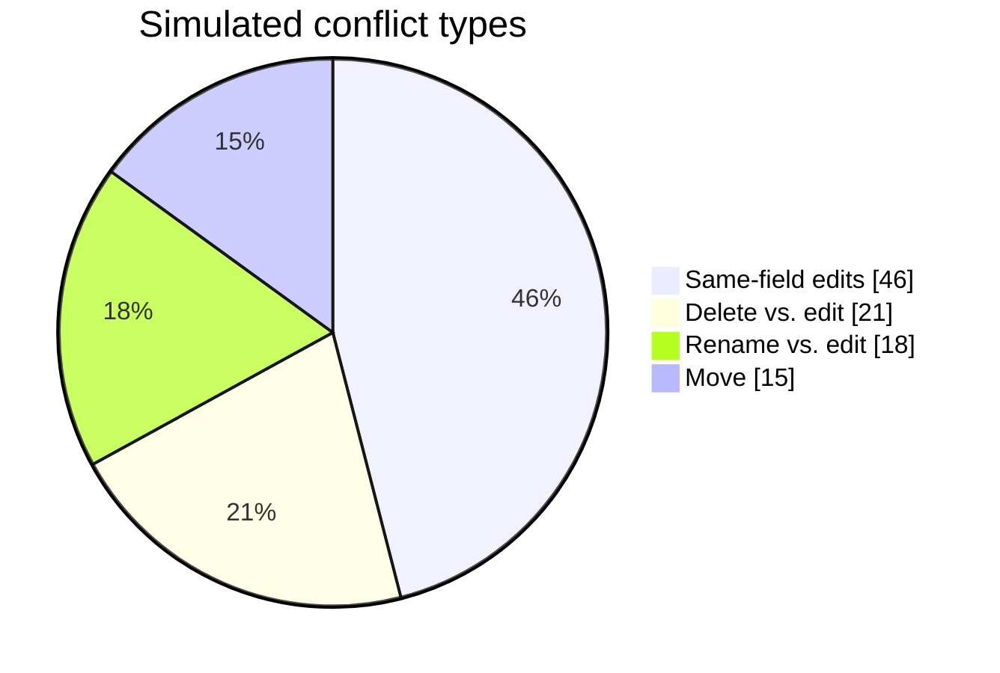
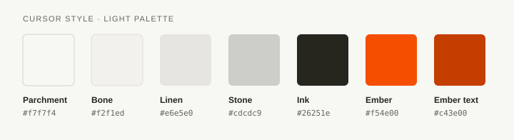

# Offline-first: sync design for note-taking apps

*A design note about trade-offs.*

This document doubles as the preview sample for the **Cursor Style** theme: it uses a real technical topic to exercise the elements you meet most often in Typora. Read it as a design note, or flip through it as a regression test.

[TOC]

## 1. Why offline-first

The most basic promise of a note-taking app is: **every word you write is kept**. The network drops on the subway, there is no signal on a flight, café Wi-Fi disconnects every few minutes—and the user just wants to keep writing. *Offline-first* treats the local copy as the source of truth; the network is only an optional channel that nudges the replicas toward agreement[^1].

This choice has three direct consequences:

1. Writes must complete locally and immediately, with latency independent of the network;
2. After several devices have edited independently, the system must converge to the same result (*eventual consistency*);
3. The sync protocol must be **idempotent**, interruptible and resumable—any request may be sent twice, or only half executed.

> A good sync system is like a patient editor: it does not decide which version is “more right”; it only makes sure every change leaves a trail.
>
> — Design notes, draft 3

### 1.1 Design goals

| Goal | Measure | Target |
| :--- | :--- | ---: |
| Local write latency | p99, including flush to disk | < 50 ms |
| Upload success on a poor network | 30% packet loss, 400 ms RTT | ≥ 99.9% |
| Time to converge | after both sides are back online | ≤ 3 s |
| Traffic per sync | 100 operations, gzip | ≤ 32 KB |

### 1.2 Non-goals

We deliberately do **not** pursue the following; each would make the protocol an order of magnitude more complex:

- Cross-note transactions (changing several notes with atomic visibility)
- Server-side reading of note bodies (a prerequisite for end-to-end encryption)
- Character-level “live cursor” collaboration
  - This is a different kind of product and needs a different transport layer
  - The approach here guarantees eventual consistency only, not millisecond visibility

## 2. Data model

A note is made of several **fields**, and every edit is recorded as an append-only **operation** instead of overwriting the old value. History is kept for free, and merging is just “union the operation sets from both sides and sort them”.

### 2.1 Clocks: who came first

Without a global clock there is no “absolute order”. Three common options:

| Approach | Relations it can express | Metadata per entry | Main drawback |
| --- | --- | --- | --- |
| Lamport clock | Total order, but concurrency is not distinguished | 8 B | Cannot detect true concurrency |
| Vector clock | Partial order, detects concurrency | Proportional to device count | Metadata grows with many devices |
| Hybrid logical clock (HLC)[^hlc] | Total order, close to wall-clock time | 12–16 B | Needs device clocks to be roughly right |

#### How vector clocks compare

Two vector clocks $V_a$ and $V_b$ are related by comparing their components one by one. If every component satisfies $V_a[i] \le V_b[i]$, then $a$ happened before $b$; if neither direction holds, the two are **concurrent**. (Inline math must be enabled under Preferences → Markdown → *Inline Math*; block math works by default.)

$$
V_A = \begin{pmatrix} 3 \\ 1 \\ 0 \end{pmatrix},\quad
V_B = \begin{pmatrix} 2 \\ 2 \\ 0 \end{pmatrix}
\;\Longrightarrow\; V_A \parallel V_B
$$

##### Why HLC won

The HLC update rule is only a few lines. Let the local clock be $(l, c)$ and the physical time $pt$. On a local event:

$$
\begin{aligned}
l' &= \max(l,\ pt) \\
c' &= \begin{cases} c + 1 & \text{if } l' = l \\ 0 & \text{otherwise} \end{cases}
\end{aligned}
$$

###### Glossary

**HLC**: hybrid logical clock. **LWW**: last-writer-wins[^lww]. **CRDT**: conflict-free replicated data type.

### 2.2 Entities and classes

A note does not store field values directly; it owns them indirectly through operations, and each operation remembers which device it came from. As an entity-relationship diagram (illustrative):



In code, a replica holds a clock and operations; a delete leaves a tombstone that can only be reclaimed once the watermark has passed it (illustrative):



## 3. How conflicts merge

Different kinds of fields merge differently. The table below is the most important one in the whole design—it decides whether users silently lose data:

| Strategy | Data structure | Merge rule | Offline writes | Concurrent edits | History kept | Typical use | Metadata cost | Learning curve | Notes |
| :--- | :--- | :--- | :---: | :---: | :---: | :--- | ---: | :---: | :--- |
| LWW register | Single value + timestamp | Larger timestamp wins | ✅ | ✅ | ❌ | Title, color, pin flag | 12 B / field | Low | Simple and predictable, but the losing write is discarded—keep a copy in history |
| G-Counter / PN-Counter | One slot per device | Per-slot maximum | ✅ | ✅ | ✅ | Read counts, likes | 8 B × devices | Low | Can only express “grow-only”, or one increment and one decrement counter |
| OR-Set | Elements + unique tag sets | Union; a delete removes only the tags it has seen | ✅ | ✅ | ✅ | Tags, attachment lists | ~24 B / element | Medium | “Add wins”: a concurrent add and delete resolve to the add |
| Sequence CRDT (RGA, Yjs, …) | Characters with unique IDs | Interleave by ID and causal order | ✅ | ✅ | ✅ | Note body | ~16–30 B / character | High | Required for the body; with LWW one side's whole paragraph vanishes |
| Keep both (conflict copy) | Whole record | No merge, create a copy | ✅ | ✅ | ✅ | Attachments that cannot be merged automatically | One full record | Low | The most honest fallback; the cost is that the user has to tidy up |

### 3.1 How likely is a conflict

Suppose an account has $N$ notes, and during one offline stretch two devices each edit $m$ notes at random. The probability that at least one note is edited on **both** sides is approximately:

$$
P(\text{conflict}) = 1 - \frac{\binom{N-m}{m}}{\binom{N}{m}} \approx 1 - e^{-m^2/N}
$$

With $k$ devices, every pair can conflict; multiply the exponent by $\binom{k}{2}$. Take $N = 2000$:

| Edits per device *m* | Two devices (exact) | Two devices (approx.) | Three devices (approx.) |
| ---: | ---: | ---: | ---: |
| 5 | 1.25% | 1.24% | 3.68% |
| 10 | 4.90% | 4.88% | 13.93% |
| 20 | 18.29% | 18.13% | 45.12% |
| 50 | 72.25% | 71.35% | 97.65% |

The conclusion is direct: **the longer devices stay offline and the more of them there are, the less a conflict is an edge case**. Designing for conflicts as the normal case is much cheaper than patching afterwards.

## 4. Sync protocol

The protocol has just two actions: **push** sends the local operations that have not been uploaded yet to the server, and **pull** brings back the operations produced by other devices. The server only appends and orders; **merging happens on the client**—so the server never needs to understand the content, which is what makes end-to-end encryption possible.



When two devices edit the same note offline at the same time, one full round trip looks roughly like this:

```mermaid
sequenceDiagram
    autonumber
    participant A as Laptop (Device A)
    participant S as Sync service
    participant B as Phone (Device B)
    A->>A: Edit offline, write to the local log
    B->>B: Edit the same note offline
    A->>S: push(ops, cursor=41)
    S-->>A: ok, cursor=44
    B->>S: push(ops, cursor=41)
    S-->>B: ok, cursor=47, remote ops (42-44)
    B->>B: Merge remote operations (ordered by HLC)
    Note over S,B: The server only appends and never rewrites; merging happens on the client
    S-->>A: pull(cursor=44)
    A->>A: Merge B's operations
```

The states a record goes through locally can be drawn as a small state machine:



## 5. Implementation snippets

### 5.1 TypeScript: hybrid logical clock

```typescript
// hlc.ts — Hybrid Logical Clock
export interface Hlc {
  wall: number;     // physical time in ms
  counter: number;  // logical tie-breaker within the same millisecond
  node: string;     // device ID, breaks exact ties
}

export function tick(local: Hlc, now: number = Date.now()): Hlc {
  const wall = Math.max(local.wall, now);
  const counter = wall === local.wall ? local.counter + 1 : 0;
  return { ...local, wall, counter };
}

export function receive(local: Hlc, remote: Hlc, now: number = Date.now()): Hlc {
  const wall = Math.max(local.wall, remote.wall, now);
  let counter: number;
  if (wall === local.wall && wall === remote.wall) counter = Math.max(local.counter, remote.counter) + 1;
  else if (wall === local.wall) counter = local.counter + 1;
  else if (wall === remote.wall) counter = remote.counter + 1;
  else counter = 0;
  return { ...local, wall, counter };
}

export const compare = (a: Hlc, b: Hlc): number =>
  a.wall - b.wall || a.counter - b.counter || a.node.localeCompare(b.node);

type Field<T> = { value: T; stamp: Hlc };

/** LWW merge: the larger timestamp wins; on an exact tie the larger node ID wins. */
export function mergeField<T>(a: Field<T>, b: Field<T>): Field<T> {
  return compare(a.stamp, b.stamp) >= 0 ? a : b;
}
```

### 5.2 Python: grow-only counter

```python
from dataclasses import dataclass, field


@dataclass
class GCounter:
    """A grow-only counter: each node edits only its own slot; merging takes the per-slot maximum."""

    node: str
    slots: dict[str, int] = field(default_factory=dict)

    def incr(self, n: int = 1) -> None:
        self.slots[self.node] = self.slots.get(self.node, 0) + n

    def merge(self, other: "GCounter") -> None:
        for node, value in other.slots.items():
            self.slots[node] = max(self.slots.get(node, 0), value)

    @property
    def value(self) -> int:
        return sum(self.slots.values())


a, b = GCounter("laptop"), GCounter("phone")
a.incr(3); b.incr(2)
a.merge(b); b.merge(a)
assert a.value == b.value == 5  # merge is commutative, associative and idempotent
```

### 5.3 SQL: append-only operation log

```sql
-- Operation log: append-only, never modified in place
CREATE TABLE note_ops (
  op_id      TEXT PRIMARY KEY,   -- ULID, generated locally on the device
  note_id    TEXT NOT NULL,
  field      TEXT NOT NULL,      -- 'title' | 'body' | 'tags' ...
  value      JSON,
  hlc_wall   INTEGER NOT NULL,
  hlc_count  INTEGER NOT NULL,
  device_id  TEXT NOT NULL,
  synced_at  INTEGER             -- NULL means not uploaded yet
);

CREATE INDEX idx_ops_pending ON note_ops (synced_at) WHERE synced_at IS NULL;

-- Latest value of each field (LWW)
SELECT note_id, field, value
FROM (
  SELECT *, ROW_NUMBER() OVER (
    PARTITION BY note_id, field
    ORDER BY hlc_wall DESC, hlc_count DESC, device_id DESC
  ) AS rn
  FROM note_ops
)
WHERE rn = 1;
```

### 5.4 Shell, JSON and YAML

The commands used most often when debugging:

```bash
#!/usr/bin/env bash
set -euo pipefail

# How many operations are still not uploaded?
sqlite3 notes.db "SELECT COUNT(*) FROM note_ops WHERE synced_at IS NULL;"

# Simulate a poor network: 400 ms delay, 30% packet loss (needs root)
sudo tc qdisc add dev eth0 root netem delay 400ms loss 30%

# Replay an upload with an idempotency key: the server should return 200 and create no duplicates
curl -sS -X POST "https://sync.example.com/v1/push" \
  -H "Idempotency-Key: $(uuidgen)" \
  -H "Content-Type: application/json" \
  --data @payload.json | jq '.cursor'
```

The payload of one push and the server's reply:

```json
{
  "cursor": "01JC3W8Z4Q9R5T7V2X6Y0A1B2C",
  "ops": [
    {
      "id": "01JC3W8YXN0E7ZK9P5M2H4D6F8",
      "note": "n_8f3a",
      "field": "title",
      "value": "Weekly sync notes",
      "hlc": { "wall": 1793064600000, "counter": 2, "node": "laptop" }
    }
  ],
  "limits": { "maxOps": 500, "maxBytes": 1048576 },
  "retryAfter": null
}
```

Client configuration:

```yaml
sync:
  endpoint: https://sync.example.com/v1
  batch:
    max_ops: 500
    max_bytes: 1MiB
  retry:
    strategy: exponential-jitter
    base: 500ms
    cap: 60s
  conflict:
    default: lww        # single-value fields
    text: crdt          # the body uses a sequence CRDT
    keep_loser: true    # losing versions stay in history
```

### 5.5 Diff and front-end snippets

Adding an idempotency key to push takes one small change:

```diff
@@ -18,4 +18,8 @@ export async function push(ops: Op[]) {
-  const res = await fetch(url, { method: "POST", body: JSON.stringify(ops) });
+  const res = await fetch(url, {
+    method: "POST",
+    headers: { "Idempotency-Key": batchId(ops) },
+    body: JSON.stringify(ops),
+  });
   if (!res.ok) throw new SyncError(res.status);
   return (await res.json()) as PushResult;
 }
```

The UI only needs a quiet status badge that does not steal the user's attention:

```html
<div class="sync-badge" data-state="offline" role="status" aria-live="polite">
  <span class="dot"></span>
  Offline · 3 changes waiting to sync
</div>
```

```css
.sync-badge {
  display: inline-flex;
  align-items: center;
  padding: 0.25rem 0.625rem;
  border: 1px solid rgb(38 37 30 / 10%);
  border-radius: 999px;
  font: 500 12px/1.4 system-ui, sans-serif;
}
.sync-badge[data-state="offline"] .dot { background: #c43e00; }
```

## 6. Launch checklist

- [x] Local operation log and HLC
- [x] push / pull and idempotency keys
- [ ] Poor-network stress test (30% packet loss, 400 ms delay)
  - [x] Single device
  - [ ] Two devices editing concurrently
  - [ ] Three devices, one with a clock 10 minutes fast
- [ ] Tombstones and garbage collection
- [ ] Staged rollout and rollback plan

Rollout plan (illustrative; the dates are demo data):



The distribution of conflict types observed in rehearsals (simulated data):



## 7. Trade-offs and reflections

**Clocks cannot be trusted.** A device whose clock is set a year ahead will win every time under LWW: every value it writes looks “newer” than what the other devices wrote. There are two usual defenses—the server rejects operations with `wall > server_now + 5 min`; the client applies the same clamp in `receive` and flags the odd device to the user. These defenses are not technically interesting, yet they are the easiest to forget.

**Tombstones need a collection line.** A delete cannot really delete, or a device that has been offline for a long time will resurrect deleted notes when it returns. So a delete only writes a *tombstone*. When can a tombstone be collected? Once every active device has acknowledged seeing it—that is, once the watermark has passed it. Devices that stay offline for a long time must be explicitly dropped from the set, or tombstones grow without bound.

**End-to-end encryption changes the division of labor.** If the server cannot see the body, it cannot merge on the client's behalf; it can only guarantee the **global order** of operations and that none are **lost**. That is a constraint on the protocol and also a gift: the server stays extremely simple, with almost no business logic to get wrong.

**Don't cut corners on the body.** LWW is good enough for titles, colors and pin flags. It is not good enough for the body: when two people edit different places in the same paragraph, LWW makes one side's whole paragraph vanish. The body needs a sequence CRDT, at the price of larger metadata and a harder implementation; mature libraries such as Yjs and Automerge are worth adopting instead of writing your own.

### 7.1 Summary

Offline-first means the local replica is the source of truth. Writes land on disk first and are shipped later; the server only *orders* operations, so merging happens on the clients. Use last-writer-wins for single-value fields, a sequence CRDT for the note body, and keep a conflict copy as the honest fallback.

> Design for the case where a user edits on a plane, in a tunnel, and on two devices at once — because sooner or later, they will.

The hardest bugs are not in the merge function. They live in clocks that lie, tombstones that never die, and retries that arrive twice.

## 8. Typography self-test

Numbers, units and punctuation are where long-form reading most often goes wrong. The sentences below are deliberately unfriendly:

Running `npm install` on macOS 26.0 takes about 3.5 seconds and 128 MB of memory; the plan costs $199.00/month (about €183), effective 2026-10-27, for the 09:30–18:00 window, at a 3:2 ratio and 99.9% accuracy. Chemical formula H<sub>2</sub>O, area 5 m<sup>2</sup>, version v1.5.6.

English “curly quotes” and 'straight quotes', ‘single curly quotes’, parentheses (like this) and [brackets], the book title *Designing Data-Intensive Applications*, an em-dash — like this, an en-dash 1–10, an ellipsis… like this, and a non-breaking hyphen in Wi‑Fi.

Shortcuts: save with <kbd>⌘</kbd> + <kbd>S</kbd> and open the command palette with <kbd>⌘</kbd> + <kbd>⇧</kbd> + <kbd>P</kbd>; on Windows use <kbd>Ctrl</kbd> + <kbd>S</kbd>. Key points can be <mark>highlighted</mark> or <u>underlined</u>, and ~~struck through~~ once obsolete; **bold**, *emphasis*, ***bold emphasis*** and `inline code` must be distinguishable at a glance.

There are three ways to write a link: inline, like the [Mermaid documentation](https://mermaid.js.org/); reference-style, like [Typora][typora] and the [CRDT resource site][crdt]; and written out directly, <https://typora.io>.

### 8.1 Palette

The image below shows the Cursor Style light palette. The emphasized line right after an image is typeset as its caption.



*Figure 1: Paper and ink form the skeleton; orange is used only for links, emphasis and focus.*

### 8.2 Deep nesting

1. First-level ordered list
   - Second-level unordered list
     1. Third-level ordered list, with slightly longer text so you can check that wrapped lines stay aligned: when a line does not fit, the continuation should line up with the first line's text rather than falling back under the number
        - Fourth-level unordered list
2. Back to the first level, with a code block:

   ```bash
   echo "Code blocks can live inside lists too"
   ```

3. And a quote:

   > A quote inside a list should look different from an outer quote.
   >
   > > One more level; the edge line should be lighter.

<details>
<summary>Expand: about HTML blocks</summary>
<p>Typora renders <code>&lt;details&gt;</code> as an HTML block. The text here uses the same typography as the body.</p>
</details>

### 8.3 Edge cases

A very long link should not break the text column: <https://example.com/a/very/long/path/that/keeps/going/and/going/and/going/until/it/must/wrap/somewhere/reasonable?query=string&another=parameter&yet-another=value#fragment>

A very long word without spaces: Pneumonoultramicroscopicsilicovolcanoconiosis_Pneumonoultramicroscopicsilicovolcanoconiosis_Pneumonoultramicroscopicsilicovolcanoconiosis.

Below is a very long command. With “no wrapping in code blocks” enabled a horizontal scrollbar should appear; by default it wraps:

```bash
curl -X POST https://sync.example.com/v1/push -H "Authorization: Bearer $TOKEN" -H "Idempotency-Key: 6f9619ff-8b86-d011-b42d-00c04fc964ff" -H "Content-Type: application/json" -H "X-Client: ember-notes/2.7.1 (macOS 26.0; arm64)" --data-binary @ops-2026-10-27T09-30-00Z.ndjson --compressed --retry 5 --retry-all-errors --max-time 30
```

A code block with no language specified:

```
plain text, no language
  indentation   is   preserved
```

The image below deliberately points to a missing file, to check what a load failure looks like:


---

## References and footnotes

The reference definitions and footnotes at the end of the document, to check the footer area.

[^1]: See Ink & Switch's article [Local-first software](https://www.inkandswitch.com/local-first/) (2019), which sets out seven ideals for local-first software.
[^hlc]: Kulkarni et al., *Logical Physical Clocks* (2014). HLC keeps the readability of physical time while guaranteeing causal order.
[^lww]: LWW is last-writer-wins. Simple and predictable, but it silently discards the losing write, so it only suits single-value fields.

[typora]: https://typora.io "Typora — a minimal Markdown editor"
[crdt]: https://crdt.tech/
