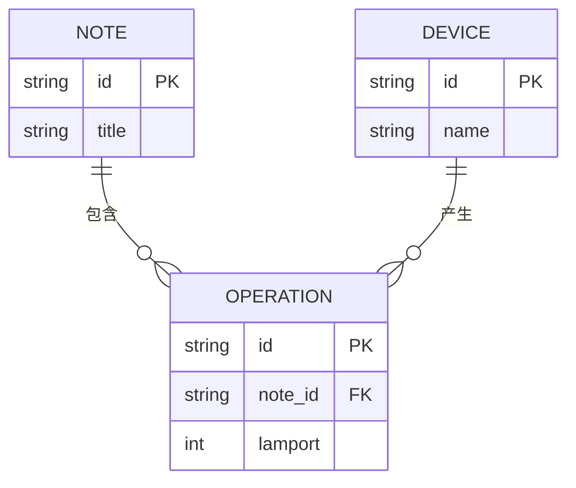
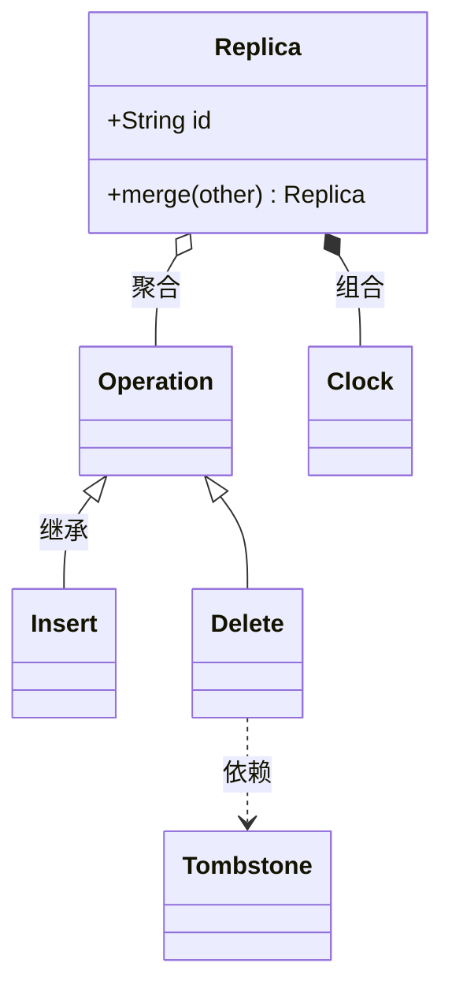
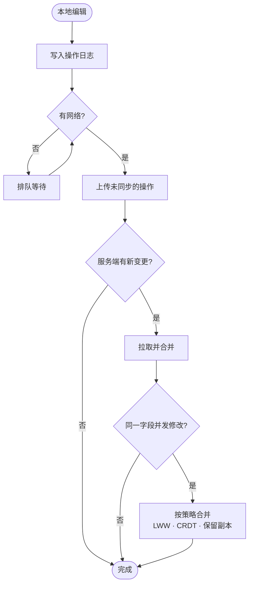
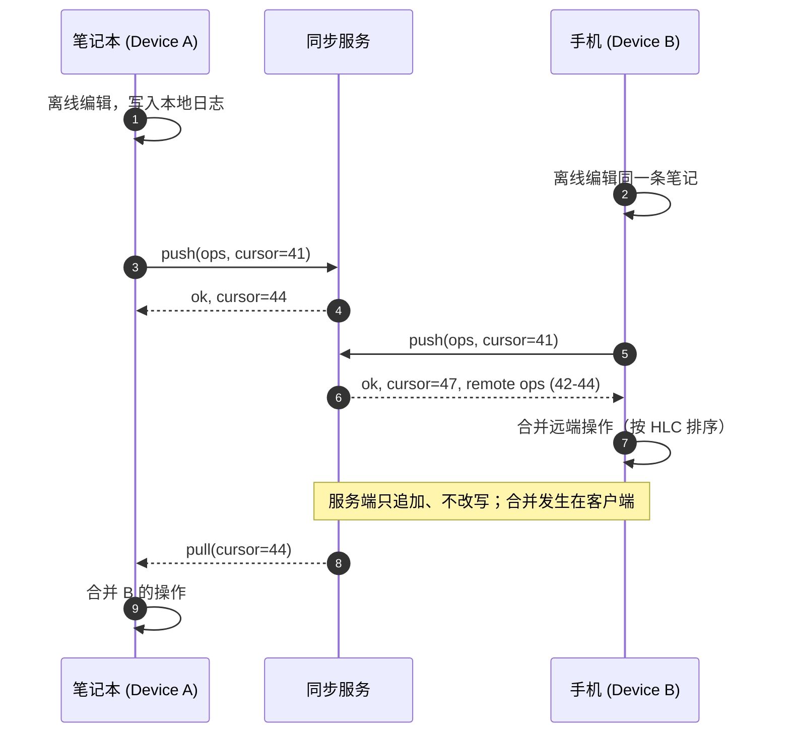
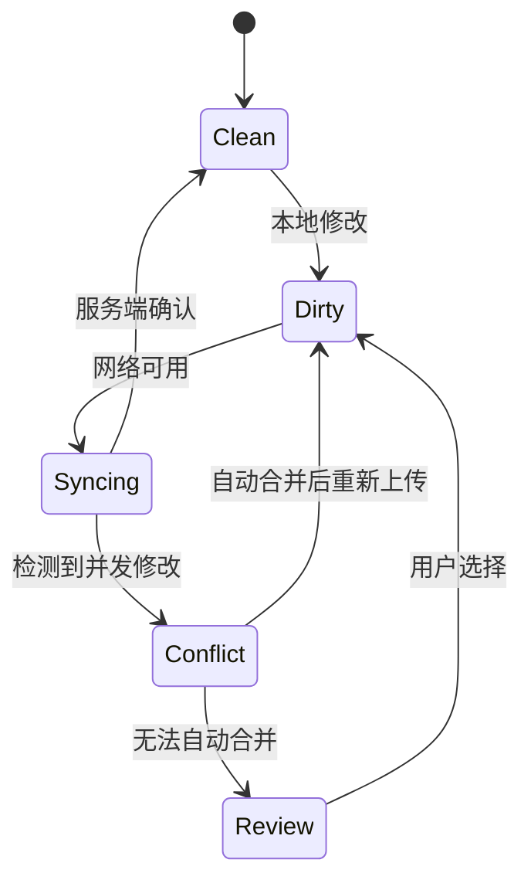
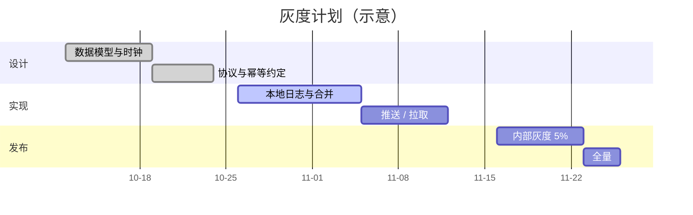
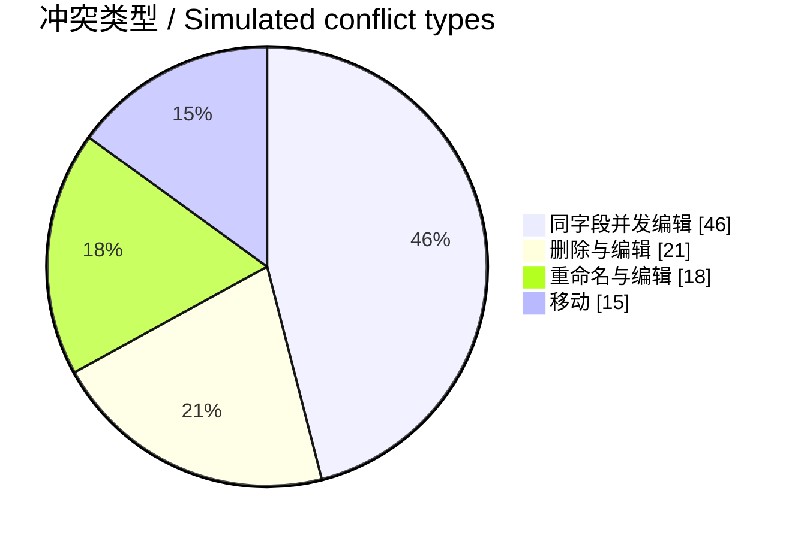

# 离线优先：笔记应用的同步设计

*Offline-first sync for note-taking apps —— 一份关于取舍的设计笔记。*

这份文档同时是 **Cursor Style** 主题的预览样例：它用一个真实的技术话题，把 Typora 里常见的排版元素都用了一遍。当文章读，是设计笔记；当样例翻，是回归测试。

[TOC]

## 1. 为什么是离线优先

笔记应用最基本的承诺是：**你写下的每个字都不会丢**。地铁里网络会断，航班上根本没有信号，咖啡馆的 Wi-Fi 每隔几分钟掉一次线——而用户只是想继续写。*离线优先*（offline-first）把本地副本当作事实来源（source of truth），网络只是让各个副本趋于一致的一条可有可无的通道[^1]。

这个选择带来三个直接后果：

1. 写入必须在本地立即完成，延迟与网络无关；
2. 多台设备各自修改之后，系统要能收敛到同一个结果（*eventual consistency*）；
3. 同步协议必须**幂等**、可中断、可恢复——任何一次请求都可能被重发，也可能只执行了一半。

> 好的同步系统像一位耐心的编辑：它不会替你决定哪个版本“更对”，只负责让每一次改动都有迹可循。
>
> —— 设计笔记，第 3 稿

### 1.1 设计目标

| 目标 | 度量 | 目标值 |
| :--- | :--- | ---: |
| 本地写入延迟 | p99，含落盘 | < 50 ms |
| 弱网下的上传成功率 | 丢包 30%、RTT 400 ms | ≥ 99.9% |
| 收敛时间 | 两端恢复联网后 | ≤ 3 s |
| 单次同步的流量 | 100 条操作，gzip 后 | ≤ 32 KB |

### 1.2 不做什么

我们刻意**不**追求以下几件事，它们会让协议复杂一个数量级：

- 跨笔记的事务（一次修改多条笔记并要求原子可见）
- 服务端读取笔记正文（端到端加密的前提）
- 精确到字符的“实时光标”协作
  - 这是另一类产品，需要另一套传输层
  - 本文的方案只保证最终一致，不保证毫秒级可见

## 2. 数据模型

每条笔记由若干**字段**组成，每次修改都被记录为一条只追加的**操作**（operation），而不是覆盖旧值。这样历史天然保留，合并也只是“把两边的操作集合并起来再排序”。

### 2.1 时钟：谁先谁后

没有全局时钟，就没有“绝对的先后”。常见的三种选择如下：

| 方案 | 能表达的关系 | 单条元数据大小 | 主要缺点 |
| --- | --- | --- | --- |
| Lamport 时钟 | 全序，但不区分并发 | 8 B | 无法发现真正的并发 |
| 向量时钟（vector clock） | 偏序，能识别并发 | 与设备数成正比 | 设备多了以后元数据膨胀 |
| 混合逻辑时钟（HLC）[^hlc] | 全序，接近物理时间 | 12–16 B | 依赖设备时间大体正确 |

#### 向量时钟的比较规则

两个向量时钟 $V_a$ 与 $V_b$ 的关系，取决于每个分量逐一比较的结果。若所有分量都满足 $V_a[i] \le V_b[i]$，则 $a$ 发生在 $b$ 之前；若两个方向都不成立，则二者**并发**。（行内公式需要在“偏好设置 → Markdown”中开启 *Inline Math*；块级公式默认可用。）

$$
V_A = \begin{pmatrix} 3 \\ 1 \\ 0 \end{pmatrix},\quad
V_B = \begin{pmatrix} 2 \\ 2 \\ 0 \end{pmatrix}
\;\Longrightarrow\; V_A \parallel V_B
$$

##### 为什么最终选了 HLC

HLC 的更新规则只有几行。设本地时钟为 $(l, c)$，物理时间为 $pt$，发生本地事件时：

$$
\begin{aligned}
l' &= \max(l,\ pt) \\
c' &= \begin{cases} c + 1 & \text{if } l' = l \\ 0 & \text{otherwise} \end{cases}
\end{aligned}
$$

###### 术语小表

**HLC**：hybrid logical clock。**LWW**：last-writer-wins[^lww]。**CRDT**：conflict-free replicated data type。

### 2.2 实体与类

笔记不直接保存字段的值，而是通过操作间接拥有它们；每条操作都记得自己来自哪台设备。用实体关系图表示如下（示意）：



落到代码里，副本持有时钟和操作；删除会留下墓碑，等水位线越过它之后才能回收（示意）：



## 3. 冲突怎么合并

不同类型的字段，合并方式不同。下面这张表是整个设计里最重要的一张——它决定了“用户会不会无声地丢数据”：

| 策略 | 数据结构 | 合并方式 | 离线写入 | 多端并发 | 历史保留 | 典型实现 | 元数据开销 | 学习曲线 | 备注 |
| :--- | :--- | :--- | :---: | :---: | :---: | :--- | ---: | :---: | :--- |
| LWW 寄存器 | 单个值 + 时间戳 | 取时间戳较大者 | ✅ | ✅ | ❌ | 标题、颜色、置顶标记 | 12 B / 字段 | 低 | 简单可预测，但落败的写入会被丢弃，务必在历史里留一份 |
| G-Counter / PN-Counter | 每设备一个槽位 | 逐槽位取最大值 | ✅ | ✅ | ✅ | 阅读计数、点赞数 | 8 B × 设备数 | 低 | 只能表示“只增”或“增减各一个计数器” |
| OR-Set | 元素 + 唯一标签集合 | 并集，删除只移除已见标签 | ✅ | ✅ | ✅ | 标签、附件列表 | 约 24 B / 元素 | 中 | “添加优先”：并发的添加与删除，添加获胜 |
| 序列 CRDT（RGA、Yjs 等） | 带唯一 ID 的字符序列 | 按 ID 与因果顺序交织 | ✅ | ✅ | ✅ | 笔记正文 | 约 16–30 B / 字符 | 高 | 正文必须用它，LWW 会让一方整段文字消失 |
| 保留两份（conflict copy） | 整条记录 | 不合并，生成副本 | ✅ | ✅ | ✅ | 无法自动合并的附件 | 一整条记录 | 低 | 最诚实的兜底，代价是需要用户来收拾 |

### 3.1 冲突概率有多高

假设一个账号共有 $N$ 条笔记，两台设备在同一段离线期间各自随机修改了 $m$ 条。至少有一条被**两边同时**修改的概率，近似为：

$$
P(\text{conflict}) = 1 - \frac{\binom{N-m}{m}}{\binom{N}{m}} \approx 1 - e^{-m^2/N}
$$

如果有 $k$ 台设备，两两之间都可能冲突，指数部分乘以 $\binom{k}{2}$ 即可。取 $N = 2000$：

| 每台设备修改条数 *m* | 两台设备（精确） | 两台设备（近似） | 三台设备（近似） |
| ---: | ---: | ---: | ---: |
| 5 | 1.25% | 1.24% | 3.68% |
| 10 | 4.90% | 4.88% | 13.93% |
| 20 | 18.29% | 18.13% | 45.12% |
| 50 | 72.25% | 71.35% | 97.65% |

结论很直接：**离线越久、设备越多，冲突就越不是“边角情况”**。把冲突当成常态来设计，比事后补救便宜得多。

## 4. 同步协议

协议只有两个动作：**push** 把本地还没上传的操作发给服务端，**pull** 拿回别的设备产生的操作。服务端只负责追加与排序，**合并发生在客户端**——这样服务端不需要读懂内容，端到端加密才成立。



两台设备同时离线编辑同一条笔记时，一次完整的往返大致如下：



每条记录在本地经历的状态可以画成一张小小的状态机：



## 5. 实现片段

### 5.1 TypeScript：混合逻辑时钟

```typescript
// hlc.ts — Hybrid Logical Clock
export interface Hlc {
  wall: number;     // 物理时间，毫秒 / physical time in ms
  counter: number;  // 同一毫秒内的逻辑计数 / logical tie-breaker
  node: string;     // 设备 ID，用来打破完全平局
}

export function tick(local: Hlc, now: number = Date.now()): Hlc {
  const wall = Math.max(local.wall, now);
  const counter = wall === local.wall ? local.counter + 1 : 0;
  return { ...local, wall, counter };
}

export function receive(local: Hlc, remote: Hlc, now: number = Date.now()): Hlc {
  const wall = Math.max(local.wall, remote.wall, now);
  let counter: number;
  if (wall === local.wall && wall === remote.wall) counter = Math.max(local.counter, remote.counter) + 1;
  else if (wall === local.wall) counter = local.counter + 1;
  else if (wall === remote.wall) counter = remote.counter + 1;
  else counter = 0;
  return { ...local, wall, counter };
}

export const compare = (a: Hlc, b: Hlc): number =>
  a.wall - b.wall || a.counter - b.counter || a.node.localeCompare(b.node);

type Field<T> = { value: T; stamp: Hlc };

/** LWW 合并：时间戳大的获胜；完全平局时 node 字典序大的获胜。 */
export function mergeField<T>(a: Field<T>, b: Field<T>): Field<T> {
  return compare(a.stamp, b.stamp) >= 0 ? a : b;
}
```

### 5.2 Python：只增计数器

```python
from dataclasses import dataclass, field


@dataclass
class GCounter:
    """只增不减的计数器：每个节点只改自己那一格，合并时逐格取最大值。"""

    node: str
    slots: dict[str, int] = field(default_factory=dict)

    def incr(self, n: int = 1) -> None:
        self.slots[self.node] = self.slots.get(self.node, 0) + n

    def merge(self, other: "GCounter") -> None:
        for node, value in other.slots.items():
            self.slots[node] = max(self.slots.get(node, 0), value)

    @property
    def value(self) -> int:
        return sum(self.slots.values())


a, b = GCounter("laptop"), GCounter("phone")
a.incr(3); b.incr(2)
a.merge(b); b.merge(a)
assert a.value == b.value == 5  # 合并满足交换律、结合律与幂等性
```

### 5.3 SQL：只追加的操作日志

```sql
-- 操作日志：只追加，永不原地修改
CREATE TABLE note_ops (
  op_id      TEXT PRIMARY KEY,   -- ULID，设备本地生成
  note_id    TEXT NOT NULL,
  field      TEXT NOT NULL,      -- 'title' | 'body' | 'tags' ...
  value      JSON,
  hlc_wall   INTEGER NOT NULL,
  hlc_count  INTEGER NOT NULL,
  device_id  TEXT NOT NULL,
  synced_at  INTEGER             -- NULL 表示尚未上传
);

CREATE INDEX idx_ops_pending ON note_ops (synced_at) WHERE synced_at IS NULL;

-- 取每个字段的最新值（LWW）
SELECT note_id, field, value
FROM (
  SELECT *, ROW_NUMBER() OVER (
    PARTITION BY note_id, field
    ORDER BY hlc_wall DESC, hlc_count DESC, device_id DESC
  ) AS rn
  FROM note_ops
)
WHERE rn = 1;
```

### 5.4 Shell、JSON 与 YAML

调试时最常用的几条命令：

```bash
#!/usr/bin/env bash
set -euo pipefail

# 本地还有多少操作没有上传？
sqlite3 notes.db "SELECT COUNT(*) FROM note_ops WHERE synced_at IS NULL;"

# 模拟弱网：延迟 400 ms、丢包 30%（需要 root）
sudo tc qdisc add dev eth0 root netem delay 400ms loss 30%

# 带幂等键重放一次上传：服务端应返回 200，且不产生重复数据
curl -sS -X POST "https://sync.example.com/v1/push" \
  -H "Idempotency-Key: $(uuidgen)" \
  -H "Content-Type: application/json" \
  --data @payload.json | jq '.cursor'
```

一次 push 的载荷与服务端回应：

```json
{
  "cursor": "01JC3W8Z4Q9R5T7V2X6Y0A1B2C",
  "ops": [
    {
      "id": "01JC3W8YXN0E7ZK9P5M2H4D6F8",
      "note": "n_8f3a",
      "field": "title",
      "value": "周会纪要 · Weekly sync",
      "hlc": { "wall": 1793064600000, "counter": 2, "node": "laptop" }
    }
  ],
  "limits": { "maxOps": 500, "maxBytes": 1048576 },
  "retryAfter": null
}
```

客户端配置：

```yaml
sync:
  endpoint: https://sync.example.com/v1
  batch:
    max_ops: 500
    max_bytes: 1MiB
  retry:
    strategy: exponential-jitter
    base: 500ms
    cap: 60s
  conflict:
    default: lww        # 单值字段 / single-value fields
    text: crdt          # 正文用序列 CRDT / body uses a sequence CRDT
    keep_loser: true    # 落败的版本保留在历史里
```

### 5.5 Diff 与前端片段

给 push 加上幂等键，只需要一处小改动：

```diff
@@ -18,4 +18,8 @@ export async function push(ops: Op[]) {
-  const res = await fetch(url, { method: "POST", body: JSON.stringify(ops) });
+  const res = await fetch(url, {
+    method: "POST",
+    headers: { "Idempotency-Key": batchId(ops) },
+    body: JSON.stringify(ops),
+  });
   if (!res.ok) throw new SyncError(res.status);
   return (await res.json()) as PushResult;
 }
```

界面上只需要一枚安静的状态徽标，别抢走用户的注意力：

```html
<div class="sync-badge" data-state="offline" role="status" aria-live="polite">
  <span class="dot"></span>
  离线 · 3 项更改待同步
</div>
```

```css
.sync-badge {
  display: inline-flex;
  align-items: center;
  padding: 0.25rem 0.625rem;
  border: 1px solid rgb(38 37 30 / 10%);
  border-radius: 999px;
  font: 500 12px/1.4 system-ui, sans-serif;
}
.sync-badge[data-state="offline"] .dot { background: #c43e00; }
```

## 6. 上线清单

- [x] 本地操作日志与 HLC
- [x] push / pull 与幂等键
- [ ] 弱网压测（丢包 30%、延迟 400 ms）
  - [x] 单设备
  - [ ] 双设备并发编辑
  - [ ] 三设备，其中一台时钟偏快 10 分钟
- [ ] 墓碑与垃圾回收
- [ ] 灰度与回滚预案

灰度计划（示意，日期为演示数据）：



演练中观察到的冲突类型分布如下（模拟数据）：



## 7. 取舍与反思

**时钟不可信。** 一台时间被调快一年的设备，会在 LWW 里永远获胜：它写下的每个值，都比其他设备“更新”。常见的防线有两道——服务端拒绝 `wall > server_now + 5 min` 的操作；客户端在 `receive` 时也做同样的钳制，并把异常设备标记出来给用户看。这类防线没有技术含量，却最容易被遗忘。

**墓碑要有回收线。** 删除不能真的删除，否则离线很久的设备回来后会让已删除的笔记“复活”。所以删除只是写入一条*墓碑*（tombstone）。墓碑什么时候能回收？当所有活跃设备都确认看过它——也就是水位线（watermark）越过它之后。久未上线的设备需要被明确地“踢出”集合，否则墓碑会无限增长。

**端到端加密改变了分工。** 服务端看不到正文，就不可能替客户端合并；它只能保证操作的**全局顺序**与**不丢**。这对协议是约束，也是福利：服务端因此极其简单，几乎没有业务逻辑可出错。

**正文别偷懒。** 标题、颜色、置顶标记用 LWW 足够好。正文不行：两个人各改了同一段的不同位置，LWW 会让其中一方的整段文字凭空消失。正文需要序列 CRDT，代价是元数据更大、实现更难；Yjs、Automerge 这类成熟的库值得直接采用，而不是自己从头写。

### 7.1 Summary in English

Offline-first means the local replica is the source of truth. Writes land on disk first and are shipped later; the server only *orders* operations, so merging happens on the clients. Use last-writer-wins for single-value fields, a sequence CRDT for the note body, and keep a conflict copy as the honest fallback.

> Design for the case where a user edits on a plane, in a tunnel, and on two devices at once — because sooner or later, they will.

The hardest bugs are not in the merge function. They live in clocks that lie, tombstones that never die, and retries that arrive twice.

## 8. 排印自测

中英文、数字与标点混排，是长文阅读里最容易出问题的地方。下面这些句子故意写得“不友好”：

在 macOS 26.0 上运行 `npm install` 约需 3.5 秒，占用 128 MB 内存；套餐 ¥199.00/月（约合 $27.5），2026-10-27 起生效，时段为 09:30–18:00，比例 3:2，准确率 99.9%。化学式 H<sub>2</sub>O，面积 5 m<sup>2</sup>，版本号 v1.5.6。

中文引号“像这样”，单引号‘像这样’，括号（全角）与 (half-width)，书名号《设计数据密集型应用》，破折号——像这样，省略号……像这样。English “curly quotes” and 'straight quotes', an em-dash — and an en-dash 1–10, plus a non-breaking hyphen in Wi‑Fi.

快捷键：保存是 <kbd>⌘</kbd> + <kbd>S</kbd>，命令面板是 <kbd>⌘</kbd> + <kbd>⇧</kbd> + <kbd>P</kbd>；Windows 上对应 <kbd>Ctrl</kbd> + <kbd>S</kbd>。重点内容可以用 <mark>高亮</mark>，也可以用 <u>下划线</u>，还可以用 ~~删除线~~ 表示已经作废；**粗体**、*强调*、***粗体加强调*** 与 `行内代码` 必须能一眼区分。

链接有三种写法：行内的 [Mermaid 文档](https://mermaid.js.org/)，引用式的 [Typora][typora] 与 [CRDT 资料站][crdt]，以及直接写出的 <https://typora.io>。

### 8.1 配色

下面这张图是 Cursor Style 亮色主题的配色。图片后面紧跟的一行强调文字，会被当作图注排版。


*图 1：纸张与墨色构成骨架，橙色只用于链接、强调与焦点。*

### 8.2 多层嵌套

1. 第一层有序列表
   - 第二层无序列表
     1. 第三层有序列表，文字稍长一些，用来观察折行后的缩进是否整齐：当一行放不下时，续行应与首行文字对齐，而不是退回到序号下面
        - 第四层无序列表
2. 回到第一层，混入代码块：

   ```bash
   echo "代码块也可以放在列表里"
   ```

3. 以及一段引用：

   > 列表里的引用应当与外层引用有所区别。
   >
   > > 再嵌套一层，边线应当更淡。

<details>
<summary>展开：关于 HTML 块</summary>
<p>Typora 会把 <code>&lt;details&gt;</code> 当作 HTML 块渲染。这里的文字与正文使用同一套排印。</p>
</details>

### 8.3 边界情况

一个很长的链接，不应该撑破版心：<https://example.com/a/very/long/path/that/keeps/going/and/going/and/going/until/it/must/wrap/somewhere/reasonable?query=string&another=parameter&yet-another=value#fragment>

一个很长的、没有空格的单词：Pneumonoultramicroscopicsilicovolcanoconiosis_Pneumonoultramicroscopicsilicovolcanoconiosis_Pneumonoultramicroscopicsilicovolcanoconiosis。

下面是一行很长的命令。开启“代码块不自动换行”时应出现横向滚动条，默认情况下会自动折行：

```bash
curl -X POST https://sync.example.com/v1/push -H "Authorization: Bearer $TOKEN" -H "Idempotency-Key: 6f9619ff-8b86-d011-b42d-00c04fc964ff" -H "Content-Type: application/json" -H "X-Client: ember-notes/2.7.1 (macOS 26.0; arm64)" --data-binary @ops-2026-10-27T09-30-00Z.ndjson --compressed --retry 5 --retry-all-errors --max-time 30
```

没有指定语言的代码块：

```
plain text, no language
  indentation   is   preserved
```

下面这张图故意指向一个不存在的文件，用来检查加载失败时的样子：


---

## 参考与脚注

文档末尾的引用定义与脚注，用来检查页脚区域的排版。

[^1]: 参见 Ink & Switch 的文章 [Local-first software](https://www.inkandswitch.com/local-first/)（2019），它提出了本地优先软件应当满足的七条理想。
[^hlc]: Kulkarni 等人，*Logical Physical Clocks*（2014）。HLC 既保留了物理时间的可读性，又保证因果顺序。
[^lww]: LWW 即 last-writer-wins。简单、可预测，但会无声地丢弃落败的写入，所以只适合“单值字段”。

[typora]: https://typora.io "Typora — a minimal Markdown editor"
[crdt]: https://crdt.tech/
